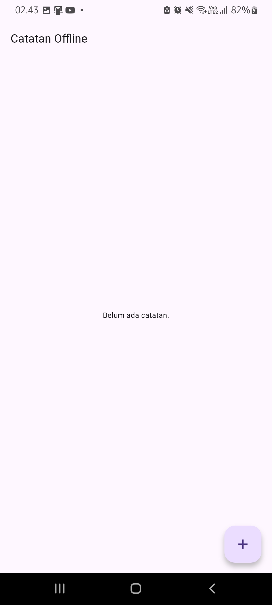
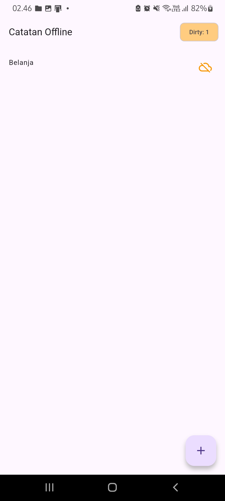
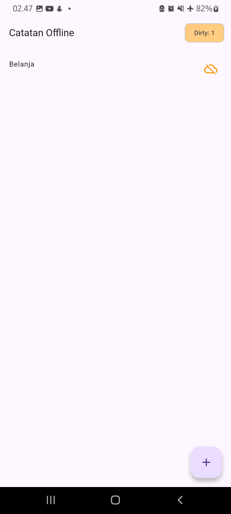
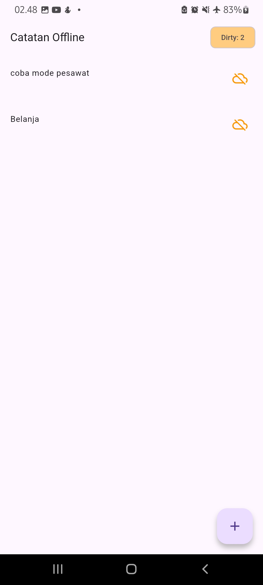
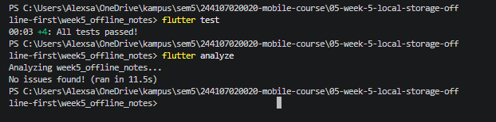

# Tugas AI Challenge - Local Storage & Offline First

## 1. Prompt yang Digunakan
> Aplikasi Flutter Offline Notes: CRUD catatan + preferensi tema.
> Bandingkan SharedPreferences, Hive, sqflite (SQLite), dan Drift untuk dua kebutuhan ini.
> Requirements:
> - Kriteria: kompleksitas query, kebutuhan relasi, reaktivitas (stream), type-safety, ukuran boilerplate, dan kemudahan testing.
> - Beri rekomendasi final: mana untuk preferensi, mana untuk catatan, beserta alasannya dalam tabel.
> - Tunjukkan skema tabel/kotak untuk 1000+ catatan.
> Jelaskan trade-off setiap pilihan.

## 2. Jawaban AI & Verifikasi (Checklist)
Berdasarkan analisis AI, berikut adalah hasil verifikasinya:

| Poin Verifikasi | Analisis & Keputusan |
| :--- | :--- |
| **Apakah menolak rapuh untuk koleksi?** | **Ya.** SharedPreferences tidak cocok untuk menyimpan list catatan (koleksi) karena tidak mendukung query, relasi, atau sorting kompleks. Menyimpannya sebagai JSON string sangat rapuh jika data besar. |
| **Apakah skema mendukung antrean sync (dirty flag / updated_at)?** | **Ya.** SQLite sangat mendukung hal ini. Kita bisa menambahkan kolom `dirty` (boolean/integer) dan `updated_at`. Saat offline, data disimpan dengan `dirty = 1`. Saat online, sistem bisa melakukan query `SELECT * FROM notes WHERE dirty = 1` untuk sinkronisasi. |
| **Apakah klaim "real-time" (Stream/Drift/watch) hanya asumsi?** | **Ya, ini asumsi yang perlu diklarifikasi.** SQLite murni (`sqflite`) tidak otomatis reaktif. Untuk membuat UI *real-time*, kita butuh state management (seperti Riverpod/Provider) untuk memicu pembaruan UI setelah operasi insert/update. Jika ingin otomatis, Drift lebih unggul karena mendukung `Stream`. |
| **Estimasi boilerplate?** | **SQLite murni** butuh boilerplate sedang (membuat helper DB, skema manual). **Drift** butuh setup awal yang lebih besar karena harus menggunakan `build_runner` untuk generate kode, tapi lebih ringkas untuk CRUD jangka panjang. |
| **Keputusan Final** | **SharedPreferences** untuk Tema, **SQLite (sqflite)** untuk Catatan. |

## 3. Alasan Keputusan Final (Trade-off)
*   **Preferensi Tema (SharedPreferences):** Data yang disimpan hanyalah nilai boolean sederhana (contoh: `isDarkMode = true`). Menggunakan database relasional untuk ini sangat *overkill*. SharedPreferences sangat ringan, cepat, dan tepat guna untuk kebutuhan *key-value* primitif.
*   **Catatan (SQLite / sqflite):** Untuk aplikasi *offline-first* dengan kebutuhan CRUD dan antrean sinkronisasi (sync queue), SQLite adalah pilihan paling solid. Kemampuannya melakukan *filtering* (misal mencari data yang `dirty`), *sorting* berdasarkan `updated_at`, dan menjamin integritas data jauh lebih baik dibandingkan SharedPreferences atau Hive. Meskipun boilerplate-nya lebih banyak dari Hive, arsitektur SQLite sudah sangat standar dan sesuai dengan praktikum modul ini.

## 4. Skema Tabel (SQLite) untuk 1000+ Catatan
Untuk menangani 1000+ catatan dengan performa baik, skema harus mendukung query cepat (menggunakan Index) dan antrean sync:

```sql
CREATE TABLE notes (
    id INTEGER PRIMARY KEY AUTOINCREMENT,
    title TEXT NOT NULL,
    body TEXT NOT NULL,
    updated_at TEXT NOT NULL, -- Disimpan dalam format ISO8601
    dirty INTEGER NOT NULL DEFAULT 0 -- 0 = Synced, 1 = Pending/Dirty
);

-- Index penting agar pencarian data yang perlu di-sync atau diurutkan cepat
CREATE INDEX idx_notes_dirty ON notes(dirty);
CREATE INDEX idx_notes_updated_at ON notes(updated_at DESC);

```

# Checklist Verifikasi Mandiri

Berikut adalah hasil verifikasi mandiri untuk tugas Local Storage & Offline First:

- [x] **UI tidak mengganggu SQLite/SharedPreferences langsung:** 
  Semua interaksi data dilewatkan melalui `NoteRepository` dan `PrefsRepository` yang di- *inject* menggunakan Provider Riverpod.
- [x] **Aplikasi penuh berfungsi dalam mode pesawat:** 
  Fitur baca, tambah, dan hapus catatan berjalan normal saat Wi-Fi dimatikan (data disimpan ke SQLite lokal).
- [x] **Badge dirty akurat sebelum/sesudah sync:** 
  Badge `Dirty: 1` muncul saat offline. Setelah fungsi `markAllSynced()` dipanggil, badge kembali ke `0` dan ikon awan kembali normal.
- [x] **`flutter analyze` tanpa issue & semua test lulus:** 
  - Hasil `flutter analyze`: **No issues found!**
  - Hasil `flutter test`: **All tests passed!** (4 test berhasil).
- [x] **Hasil AI diverifikasi dan didokumentasikan:** 
  Analisis perbandingan storage (SharedPreferences vs SQLite) dan verifikasi rekomendasi AI telah didokumentasikan di file `README.md` 

# Bukti Pengerjaan (Screenshots)

Berikut adalah bukti visual dari aplikasi dan pengujian yang telah dilakukan:

1. **Tampilan Awal (Home Kosong)**
   

2. **Menambah Catatan Baru**
   

3. **Daftar Catatan (Status Dirty/Offline)**
   

4. **Mode Pesawat (Offline-First)**
   

5. **Hasil Flutter Analyze & Flutter Test**
   

   # Refleksi

1. **Mengapa daftar catatan tidak boleh disimpan di SharedPreferences? Apa yang rusak jika aturan ini dilanggar?**
   SharedPreferences dirancang untuk data primitif *key-value* (seperti boolean atau string pendek). Jika menyimpan daftar catatan di sini, kita harus mengubahnya menjadi JSON string yang panjang. Hal ini akan merusak performa (memori dan waktu *parsing*), menyulitkan proses *query* (misal: mencari catatan yang *dirty* atau mengurutkan berdasarkan `updated_at`), dan sangat rawan *corrupt* atau kehilangan data jika aplikasi tertutup mendadak.

2. **Kapan cache-first cukup, dan kapan Anda membutuhkan strategi lain?**
   *Cache-first* sangat cocok untuk data yang tidak terlalu sering berubah dan lebih mengutamakan kecepatan akses lokal (seperti daftar catatan offline). Namun, untuk data yang sangat dinamis dan butuh pembaruan *real-time* (misalnya harga saham atau status pengiriman), strategi *cache-first* kurang tepat karena pengguna bisa melihat data *stale* (basi). Untuk kasus itu, dibutuhkan strategi *Network-first* atau *Stale-while-revalidate*.

3. **Bagaimana dirty flag berubah menjadi antrean sync tanpa memblokir UI?**
   Saat user menambah/mengedit catatan (saat offline), data disimpan ke SQLite lokal dengan `dirty = 1`. Proses sinkronisasi (memanggil API) dijalankan secara *asynchronous* di *background*. UI tidak perlu menunggu proses ini selesai; user bisa langsung lanjut beraktivitas. Setelah *background process* sukses, flag `dirty` diubah menjadi `0` (`markAllSynced`). Antrean terpisah (seperti *outbox pattern*) menjadi perlu jika kita ingin mencatat riwayat detail setiap operasi (insert/update/delete) agar bisa di-*replay* jika terjadi konflik.

4. **Bagian mana dari rekomendasi AI yang Anda tolak, dan mengapa?**
   Saya menolak rekomendasi AI yang menyarankan penggunaan **Drift** untuk aplikasi sederhana ini. Meskipun Drift menawarkan *type-safety* yang lebih baik dan fitur *stream* bawaan, kurva pembelajaran (learning curve) dan *boilerplate* awal (seperti konfigurasi `build_runner` dan file *generated*) terlalu berlebihan untuk kebutuhan aplikasi *offline-first* skala kecil ini. Saya tetap memilih **sqflite** murni karena implementasinya lebih langsung, ringan, dan sudah sangat mencukupi untuk menangani antrean sinkronisasi berbasis query `WHERE dirty = 1`.